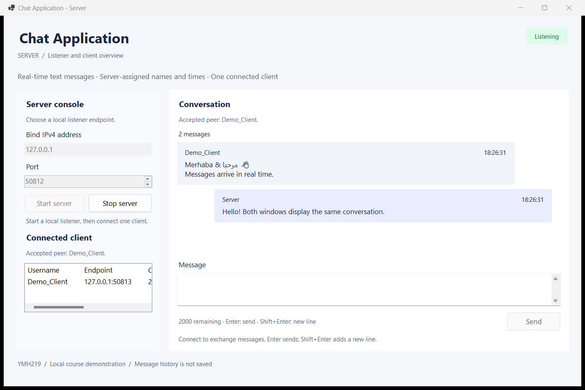
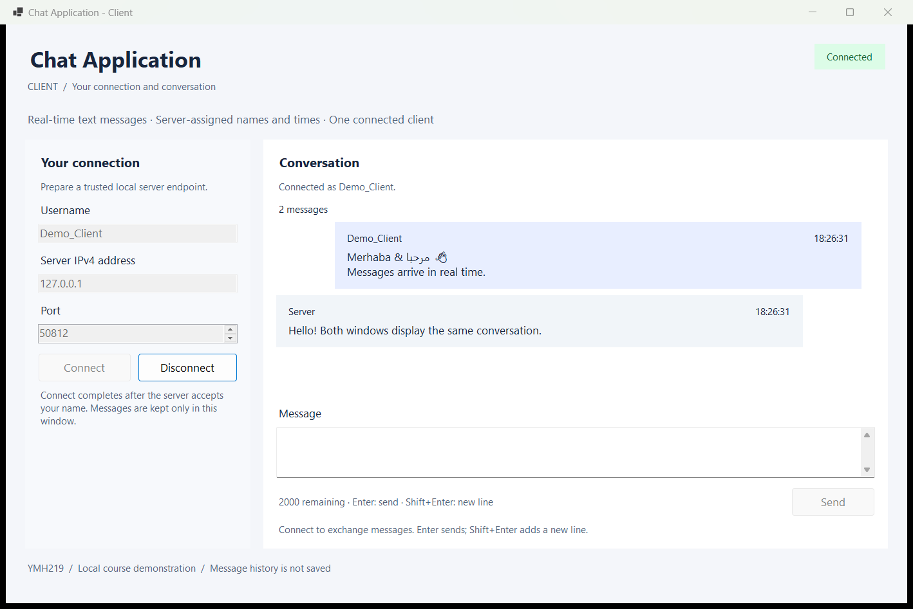
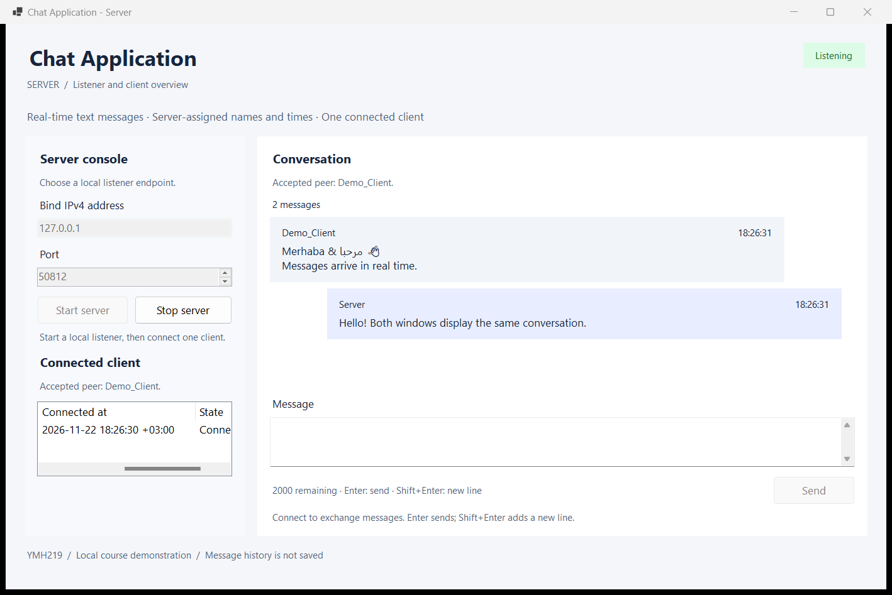

# YMH219 · Chat Application

A native Windows Forms client–server chat application for **Nesne Tabanlı Programlama (YMH219)**, by **Alaa Madi**.

**Status: P06 final-review candidate.** The working baseline is merged in [PR #6](https://github.com/alaamadii/chatApplication/pull/6). Final preparation includes genuine screenshots, a requirements audit and published-checkout verification. Required physical, trusted-LAN and second-computer evidence remains pending; see the [submission checklist](docs/submission/CHECKLIST.md).

## Features

- Start/Stop a TCP server and Connect/Disconnect a client with a validated display name.
- Exchange real-time text with the Server operator, with explicit author and local timestamps.
- Display each authoritative message once in acceptance order. Deliberately sending equal text twice creates two messages.
- Compose Turkish, Arabic, emoji and multiline text. Enter sends, Shift+Enter adds a line and Tab navigates. The limit is 2,000 UTF-16 units; an emoji surrogate pair counts as two.
- Inspect the accepted client's name, actual remote IP/port, connection date/time and state. Pending/rejected peers never create a row.
- Keep the latest 500 messages per window, with a persistent notice when older entries are removed.
- Retain an unconfirmed draft and its warning until a successful confirmed send. Recovery is explicit.

The baseline supports **one accepted client plus the Server operator**. Additional clients receive server_busy. Rooms, private messages and saved history remain deferred.

## Build and run

Use Windows, Git, PowerShell 5.1+ and a .NET 10 SDK compatible with [global.json](global.json), plus the WindowsDesktop runtime. The verified SDK is **10.0.402**. No database, API key or external UI framework is needed.

```powershell
git clone https://github.com/alaamadii/chatApplication.git
cd chatApplication
./scripts/dev.ps1 doctor
./scripts/dev.ps1 check
./scripts/dev.ps1 run-server
```

For the unmerged final-review candidate, switch to docs/final-submission before running the checks. After owner merge, use main. In another PowerShell terminal in the same checkout:

```powershell
./scripts/dev.ps1 run-client
```

1. Start Server on 127.0.0.1:5000, or choose another free matching port.
2. Enter a supported username in Client and Connect. Connected requires an accepted username handshake.
3. Send text from Client and reply from Server. Both windows show the same author/body/time sequence.
4. Inspect Server's Connected client list. Scroll horizontally for all columns; its tooltip/accessibility description includes the complete connection date/offset.
5. Disconnect/reconnect explicitly, then Stop Server or close either window. Live client information clears when its session ends.

Send requires an accepted peer and valid nonblank text. One submission is pending at a time. The Client clears its unchanged draft after its own authoritative echo is displayed; an unrelated Server message cannot confirm it. If a send is unconfirmed, inspect the retained text before explicitly reconnecting/retrying.

Shared VS Code role/compound launch configurations are included. Physical F5/debugger validation remains pending. See [ENVIRONMENT](docs/setup/ENVIRONMENT.md) for prerequisites, commands, recovery and the deliberate trusted-LAN procedure.

## Actual application screenshots

Captured on **2026-11-22**, from Release build source **1234b22205750059439cb8b5b16349edd4afc95c**, at **125% (DPI 120)**. These are complete application-window captures with synthetic messages exchanged through the real Server/Client. Owner screenshot approval is pending.

**Server — accepted client, actual remote endpoint and bidirectional conversation.**



**Client — the same conversation with outgoing and incoming messages.**



**Connection details — native list scrolled to the full local connection date and offset.** The sidebar supports horizontal scrolling for the remaining columns.



[Capture provenance and SHA-256 manifest](docs/frontend/assets/screenshots/manifest.json) · [Approval/evidence status](docs/submission/CHECKLIST.md). Original [Client](docs/frontend/assets/client-wireframe.svg) and [Server](docs/frontend/assets/server-wireframe.svg) wireframes remain synthetic design proposals.

## Architecture and validation

C#/.NET 10, Windows Forms, TcpListener/TcpClient and BCL JSON/framing. Core owns pure rules/immutable messages; Networking owns sockets/protocol/lifetimes; Presentation owns native controls; separate Server/Client executables compose them. No production external packages are required.

The latest executed suite has **139 passing cases: 31 Core, 80 Networking and 28 native App**, with no skipped cases. The development check restores, builds Release, runs tests, verifies formatting and validates documentation plus screenshot integrity. Actual-process checks cover Unicode/multiline exchange, repeated equal text, client metadata, explicit recovery, controlled errors and shutdown. Exact local/hosted/published-checkout receipts are in [TESTING](docs/quality/TESTING.md) and the final-review PR.

## Limits and remaining evidence

TCP is plaintext and names are unauthenticated display claims. Use loopback or a deliberately configured trusted LAN. There is no saved history, automatic reconnect/resend, human-read receipt or exactly-once guarantee across sessions. An interrupted send may already have reached the peer.

The owner reported physical checks **not performed** on 2026-11-22. Keyboard/IME/focus, accessibility, VS Code F5, other display settings/monitor transitions, genuine two-machine LAN and another Windows computer remain pending. Scripted 125% captures and another checkout on this computer do not replace those checks.

## Documentation and delivery

| Read | Purpose |
| --- | --- |
| [Documentation index](docs/README.md) | Organized navigation |
| [Overview](docs/product/OVERVIEW.md) / [Requirements](docs/product/REQUIREMENTS.md) | Scope and source/test traceability |
| [Stack](docs/technology/STACK.md) / [Environment](docs/setup/ENVIRONMENT.md) | Tools, versions and reproducible setup |
| [Architecture](docs/architecture/ARCHITECTURE.md) / [Protocol](docs/architecture/PROTOCOL.md) / [Decisions](docs/architecture/DECISIONS.md) | Ownership, wire contract and rationale |
| [UX](docs/frontend/UX.md) / [Design system](docs/frontend/DESIGN_SYSTEM.md) / [File guide](docs/frontend/FILE_GUIDE.md) | Controls, colors and file/resource ownership |
| [Plan](docs/planning/PLAN.md) / [Tasks](docs/planning/TASKS.md) / [Workflow](docs/planning/WORKFLOW.md) | Separate milestones, backlog and review process |
| [Testing](docs/quality/TESTING.md) / [Security](docs/quality/SECURITY.md) | Actual evidence and boundaries |
| [Submission](docs/submission/CHECKLIST.md) / [Development](docs/history/DEVELOPMENT.md) / [Sources](docs/references/SOURCES.md) | Remaining owner actions, history and authority |

Repository: [alaamadii/chatApplication](https://github.com/alaamadii/chatApplication). Course deadline: **2026-11-30, 23:59**, institutional timezone unspecified. The owner submits their GitHub profile link and approves merging. Final preparation is not a claim of course submission or completed manual acceptance.

See [AGENTS.md](AGENTS.md) for the working agreement.
